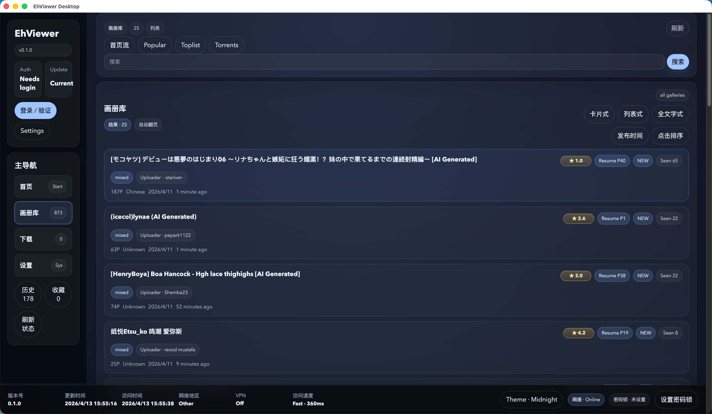

# 角崖 官方發佈頁

這裡是「角崖」的公開下載入口，統一提供 Android 與 Desktop 的安裝包、
版本說明與使用引導。本頁只放編譯好的安裝包，不含原始碼。

## Android

目前公開版本：`3.0.2.5`

### 下載

| 檔案 | 說明 |
| --- | --- |
| `EhViewer-v3.0.2.5-channel-0000-r2611-release.apk` | 主推版，一般安裝首選 |
| `EhViewer-v3.0.2.5-channel-0000-legacy-release.apk` | 相容舊版（`com.hippo.ehviewer`） |

- 發佈頁：
  <https://github.com/loututu114-pixel/eh-tw/releases/tag/android-v3.0.2.5>
- 官方短連結：
  <https://app.downlogin.com/d/8f34e44123aceb82>
- 最新版本說明：`android/latest/README.md`

### 快速開始

1. 下載上表的主推版 APK。
2. 於裝置上開啟檔案並允許安裝。
3. 若你要從舊套件識別碼升級，改用「相容舊版」。

公開頁面只展示官方包資訊，不展示渠道包資訊。

## Desktop

目前公開版本：`0.2.9`

### 推薦下載

| 平台 | 建議檔案 | 說明 |
| --- | --- | --- |
| macOS | `universal.dmg` | 一般安裝首選，適合大多數 Mac |
| Windows 10/11 64 位元 | `x64-setup.exe` | 一般安裝首選 |
| Windows 32 位元 | `ia32-setup.exe` | 僅在 32 位元系統上使用 |
| 免安裝需求 | `portable.exe` | 測試、隨身碟、免安裝使用 |

### 直接下載連結

| 平台 | 檔案 | 直接連結 |
| --- | --- | --- |
| macOS Universal | `EhViewer.Desktop-0.2.9-universal.dmg` | <https://github.com/loututu114-pixel/eh-tw/releases/download/desktop-v0.2.9/EhViewer.Desktop-0.2.9-universal.dmg> |
| Windows 64-bit Setup | `EhViewer.Desktop-0.2.9-x64-setup.exe` | <https://github.com/loututu114-pixel/eh-tw/releases/download/desktop-v0.2.9/EhViewer.Desktop-0.2.9-x64-setup.exe> |
| Windows 64-bit Portable | `EhViewer.Desktop-0.2.9-x64-portable.exe` | <https://github.com/loututu114-pixel/eh-tw/releases/download/desktop-v0.2.9/EhViewer.Desktop-0.2.9-x64-portable.exe> |
| Windows 32-bit Setup | `EhViewer.Desktop-0.2.9-ia32-setup.exe` | <https://github.com/loututu114-pixel/eh-tw/releases/download/desktop-v0.2.9/EhViewer.Desktop-0.2.9-ia32-setup.exe> |
| Windows 32-bit Portable | `EhViewer.Desktop-0.2.9-ia32-portable.exe` | <https://github.com/loututu114-pixel/eh-tw/releases/download/desktop-v0.2.9/EhViewer.Desktop-0.2.9-ia32-portable.exe> |

- 發佈頁：
  <https://github.com/loututu114-pixel/eh-tw/releases/tag/desktop-v0.2.9>
- 完整說明：`desktop/README.md`
- 更新與校驗資訊：`desktop/latest/`

### 快速開始

**macOS**

1. 下載 `universal.dmg`。
2. 開啟映像檔後把 App 拖進 `Applications`。
3. 第一次啟動若被 Gatekeeper 攔住，請在 Finder 右鍵選 `Open`。

**Windows**

1. 下載 `x64-setup.exe`，執行安裝程式。
2. 若不想安裝，改用對應架構的 `portable.exe`。

## English Summary

- This repository is the shared public release hub for both Android and Desktop.
- Android users should download the primary APK listed in the Android section.
- Desktop users should start with `universal.dmg` on macOS or `x64-setup.exe` on
  Windows.
